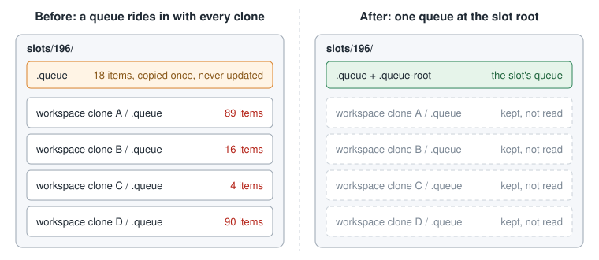

# Five Queues in One Slot

*Continues from [The File That Should Never Be Deleted](2026-11-05-mdp01-the-file-that-should-never-be-deleted.md).*

I wanted to type `work end` and have it land, promote and publish whatever was finished. Before I'd let it loose on real directories I asked Claude to survey every slot, clone and workspace on the machine and tell me what the command would do in each.

The survey was meant to be read-only. It wasn't.

## A read that renamed files

Claude ran the context resolver inside one of my slots to see what it reported. The resolver moved the slot's `.plan` to `.plan.bak` and wrote a fresh `.queue`. Nobody had asked it to write anything.

Reading the queue had a migration buried in it. So did resolving context, which moved lifecycle files out of a `design/` folder and deleted the originals. A third one turned up only when Claude wrote a test that compared every file byte for byte before and after a read: detecting state merged an old `.meta` into `.plan` and deleted it.

Three writes, all hiding behind verbs like *read*, *resolve* and *detect*. Eight workspaces and one slot were still on the old `.plan` name, five more on the `design/` layout. Each was waiting for the first tool to look at it.

The rule now is blunt. A read changes nothing. The rename happens when something writes the queue, and it says so:

```
MIGRATED_PLAN=<workspace> (.plan kept as .plan.bak; the queue is now .queue)
```

The first fix was wrong too. It retired `.plan` on every queue write, and the workspace I work in tracks an old `.plan` beside its `.queue`. One landing later I had an uncommitted deletion of a tracked file. Only the write that creates `.queue` retires the older file now.

## Five queues, none of them right

I'd been saying "a slot has one queue". I believed it.

A slot is a directory of clones: several project repos and their workspace repos, cut for one piece of work. The queue is a tracked file in each workspace repo. So every workspace clone arrives carrying that repo's whole backlog.

Claude compared the files in my busiest slot. The root had a queue of 18 items. The four workspace clones had 89, 16, 4 and 90, each naming a different branch as the live one.



The tools read the workspace clone's queue first, so which backlog you were working from depended on which directory your shell happened to be in. The copy at the root was a snapshot the close ceremony made once and never touched again.

I'd spent a while on how to keep queues in step between a clone and its canonical repo. A separate Claude had even built a store that pushed and pulled them, and hard-reset the local copy when the two disagreed. Looking at five queues that had drifted without anyone noticing, the answer went the other way. There's no reason to ever sync a queue. It's local to the area of work it describes: one slot, one clone, one canonical workspace.

That made the rule small enough to live in one function:

1. a slot or clone carrying a `.queue-root` marker uses the queue at its root, from any directory inside it
2. a workspace whose `.notes` worktree already holds a queue uses that
3. a workspace with its own `.queue` keeps it, and a worktree appearing never hides it
4. a new workspace with a `.notes` worktree starts its queue there

About sixty places in the tooling touched the queue. Nearly all went through the same reader and writer, so the rule went there and everything followed. The handful that built the path by hand were the dangerous ones.

Claude's first tests for this passed with the rule deleted. They handed the pipeline the root queue's path, so nothing ever tried the wrong one. Rewritten to hand over the inherited queue's path, the way an unswitched slot does, they found a step still writing to it.

Existing slots aren't converted. I switch them one at a time: a command lists the queues it finds, I pick, the old root copy is kept under a dated name, and the inherited files stay where they are.

## The worklog only remembered beginnings

Partway through I asked whether all of this was going through the worklog database. I assumed yes.

Claude checked. Starts were recorded. The last *end* was sixteen days old, the last *pause* was from August, and landing, publishing and promotion had never had an event type at all. Every work item created in the previous two days was still marked active.

The landing code had been rewritten and the recording hadn't come with it. A trace that only shows what began is worse than none, because it looks complete.

Each script now records its own action as it performs it: every step of a command, a stop with its reason, `land`, `stamp`, `publish`, `publish-failed`, `promote`. A failed write to the worklog prints a warning and never fails the action.

That rule was broken almost immediately. A detail field named `action` collided with the recorder's own argument and took the whole command down. Then the tests wrote seven rows into my real database, because one test file copied its environment before the per-test isolation existed. There were 797 older rows from the same leak.

Numbered slots still scaffold their queue the old way when they're created, and that's next. After that, a slot, a clone and a long-lived agent directory are the same shape: a root, a queue, a set of repos. I'd like them to be one thing.
