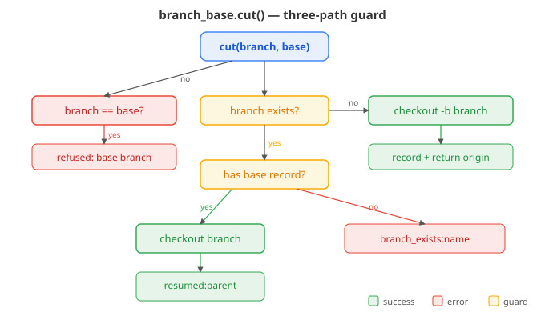

# Branch exists is not a crash

The worklog had been screaming for days. Seven `project_branch_failed: fatal: a branch named 'main' already exists` stops. Two more for `issue-726-race-scanner-address-mismatch`. Scattered others. Every one of them meant a session that asked to start work, got told no by git, and left the user to figure out why.

The root is `branch_base.cut()` — the function that creates a working branch in a repo and records where it was cut from. Before today, it had exactly one code path: `git checkout -b branch start_sha`. If git said no, `cut()` returned the raw error string. No guard. No recovery. No structured information about what went wrong.

## The "main" problem

The seven `main` failures were the most confusing. How does `cut()` get asked to create a branch called `main`? The branch-name handler explicitly says to reject it. But the handler is a judgment step — advice to the LLM, not enforcement. When the pipeline retried after a failure, the branch name sometimes carried through as the base branch itself. The mechanical layer trusted what it was given.

The fix is a two-line guard at the top of `cut()`: if the branch name equals the base branch or is `HEAD`, refuse before touching git. Structured error, not a git stack trace.

## The "already exists" problem

The other failures were branches left behind by partially completed starts. A previous `work start` made it past `create_branches` in the project repo but failed on the workspace (dirty checkout, untracked file conflict, network hiccup). Next attempt: the project branch exists, git refuses to create it, the whole thing stops.

But the branch isn't a stranger — it was created by the same pipeline, for the same issue, in a previous attempt. The evidence is right there in `refs/soredium/base/<branch>`, the ref that `cut()` writes when it creates a branch. If that ref exists, the branch is known. Check it out and carry on.

If the branch exists but has *no* base record, something unexpected happened — a manual branch, or one from a different workflow. That gets a structured `branch_exists:` error, not a raw git message. Clear enough for the LLM to suggest deleting it or picking a different name.

## Rollback matters

The interesting wrinkle was rollback. `create_branches_typed()` creates branches in two repos atomically — project first, workspace second. If workspace fails, it deletes the project branch. But if the project branch was *resumed* (it already existed), deleting it would destroy pre-existing work. The fix tracks whether each repo's branch was newly created or resumed, and only deletes on rollback when it was newly created.

The `resumed` flag on `CreateResult` only counts the two primary repos — project and workspace. An earlier version used a shared `nonlocal` boolean across all repos including slot siblings, which meant a resumed branch in a design repo would mark the entire operation as "resumed" even when the primary repos were freshly created. The review caught that one.

## What it opens up

Thirteen tests cover the combinations: base branch refused, known branch resumed, unknown branch errored, slot with branch in one repo only, rollback that preserves pre-existing branches. The seven `main` failures and the `already exists` failures should both stop appearing in the worklog.

The structured error codes (`refused:`, `branch_exists:`, `resumed:`) also make it possible for a future pipeline change to present these as decisions rather than hard failures — "this branch exists but isn't from work-start, delete it or pick another name?" That's not wired up yet, but the information is there.
