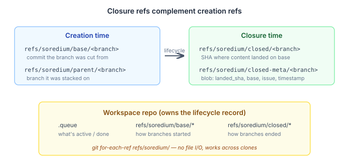

# Three guards and a ref

The lifecycle machinery has been running long enough that the failure modes are no longer hypothetical. Today's work fixed three of them — each one a gap where the system assumed something that wasn't always true.

## locate() trusted its inputs

`canonical_sync.locate()` resolves a slot clone to its canonical repo by reading the `local` remote. The assumption: `local` always holds a filesystem path. In practice, some older slots still carry `origin` remotes pointing at GitHub, and there's nothing preventing a misconfigured `local` from being a URL too. If it were, `locate()` would pass `https://github.com/casehubio/engine.git` to `Path()`, and Python would happily treat it as a relative path — four directories deep, none of them real.

We added an explicit URL guard. Before the existing `_is_repo` check, `locate()` now matches against `://` schemes and SCP-style `git@host:` patterns, raising `local_is_url` with a clear message. Credentials in the URL are redacted through the same `redact()` function that sanitises push error messages. A second fix resolves relative paths from the repo directory rather than the working directory — `../../engine` from `/family/slots/7/engine/` should reach `/family/engine/`, not wherever Python happened to be running.

## Pipeline state files were tracked

`.work-progress`, `.wrap-log.jsonl`, `.land-ledger.jsonl`, and `.workspace` were committed to workspace repos as tracked files. Every pipeline run modified them. Every rebase risked conflicts on files whose content was ephemeral. The workaround — `git update-index --assume-unchanged` — papered over the symptom without fixing it.

We untracked all four with `git rm --cached` and added them to `.git/info/exclude` (not `.gitignore` — these are tool files, not project convention). New clones and slots get the exclude entries automatically through `_EXCLUDE_ENTRIES` in `slot_git.py`.

The `.workspace` marker had a subtler problem: `ctx.py` was writing it on a read path. If the marker named the wrong project, `resolve()` would silently rewrite and commit it — a protocol violation of `a-read-never-writes`. Now it reports `marker_stale` and changes nothing. The marker is `workspace-init`'s responsibility, not every session's.

## Closed branches left no structured record

When a branch closes, the stamp commit records what happened in its message: `chore: branch closed — landed as <SHA> on main`. Parsing commit messages to reconstruct lifecycle state is fragile — it works until someone amends a stamp or the format drifts.

We added `closure_refs.py`, a module that writes structured git refs at close time:

- `refs/soredium/closed/<branch>` — the SHA where content landed on the base branch
- `refs/soredium/closed-meta/<branch>` — a blob containing `landed_sha`, `landed_on`, `issue`, and `closed` timestamp

The creation-time refs (`refs/soredium/base/`, `refs/soredium/parent/`) record how a branch started. The closure refs record how it ended. Both live in the workspace repo, readable with `git for-each-ref` — no file I/O, no database, works across clones.

Claude caught one thing in review: the `CLOSED_REF` was recording the post-stamp branch tip instead of the landed SHA. After `stamp()` runs, `rev-parse refs/heads/<branch>` returns the stamp commit, not the content that was landed. The fix was straightforward — use the `landed_sha` directly instead of reading the branch.

The stamp commit stays for backward compatibility. The refs are what tools should read going forward.
