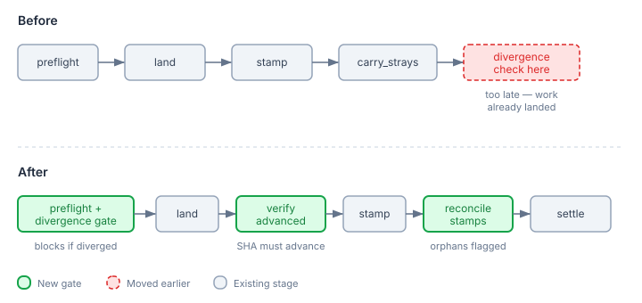

# Hardening the ceremony

The close ceremony lands branches, stamps them, advances the queue, and settles clones. Until today, each stage trusted the previous one to have succeeded. That trust was misplaced in at least three ways.

## A diverged clone could land silently

When a permanent clone's base branch diverges from canonical — commits on both sides, neither a descendant of the other — the ceremony detected it, but only at `carry_strays` time, after the feature branch had already been rebased and landed. The rebase succeeded mechanically (it only replayed feature commits onto canonical's current main), but the resulting code was tested against the clone's state, not canonical's. If the divergence introduced a conflicting change, the landed code could be subtly wrong.

The fix moves the divergence check into `preflight()`. Before any mutation, each target's repo is checked with `canonical_sync.follow()`. A diverged base now blocks the ceremony with a named error. A clone that is merely ahead — extra commits but still a descendant — lands normally. The distinction matters: ahead is catch-up work for `carry_strays`; diverged is a state that needs human resolution.

## Nothing verified that landing took

`land_all()` in canonical_sync does verify its own fast-forward succeeded — `advance()` raises `SyncError` if the base branch didn't move. But the ceremony's stage transitions were not gated on the result. `land_targets()` could return a result with an empty SHA (a code path that shouldn't happen, but defensive code assumes it can), and the next stage would stamp that empty SHA onto the branch.

Two gates now sit between landing and stamping. First, every target must have a non-empty SHA in the result dict — the stage invariant from the previous session's work. Second, `verify_landing_advanced()` confirms the base branch SHA actually changed (not equal to `before_sha`) and that no merge commits were introduced in the range. The linear-history check is belt-and-suspenders — `advance()` only does fast-forward — but it catches any future change that breaks that invariant.

After the ceremony completes, `reconcile_stamps()` walks every closed branch's closure ref and verifies its `landed_sha` is still an ancestor of main. An orphaned stamp — reachable from no current branch — gets reported as a warning. This catches historical corruption: a force-push or rebase that moved main out from under a previously valid stamp.

## Settlement can't just warn

`settle_permanent_clone()` returns each clone to its base branch after a ceremony. When it couldn't — uncommitted changes, commits canonical doesn't have, a checkout that failed — it appended a warning string and carried on. The caller added those warnings to the result, and the ceremony reported success.

The problem: a clone left on a working branch after landing looks like unfinished work to the next session. It's not an advisory finding; it's a state violation. `settle_permanent_clone` now raises `SettlementError` with the list of unsettled clones. The ceremony catches it and downgrades to warnings — same end result for the user, but the error boundary is explicit and testable.

## A queue bug, while we were in the neighbourhood

`mark_done` marks the active queue item done and activates the next one. If called twice — a pipeline retry, a re-invocation — the second call finds the newly activated item and marks it done too, on the previous item's branch. The guard: if the queue's branch state is empty (cleared by the first call), `mark_done` now refuses. The item was never started; marking it done on someone else's branch is wrong.

The underlying issue is idempotency. `mark_done` mutates state (clears the branch, activates the next item) and then succeeds on re-invocation against the mutated state. The fix is cheap — a single conditional before the mutation — but the class of bug is worth watching. Any function that mutates state and can be retried needs either idempotency guards or a check-before-act pattern.
